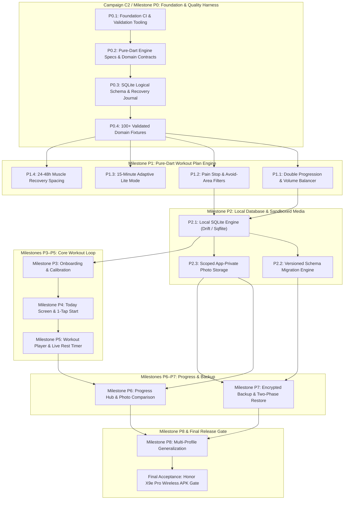

# HOMESETS — MVP Feature & Acceptance Dependency Graph

**Document Status:** [Active Engineering Architecture]  
**Author:** Antigravity (Gemini 3.8 Flash High)  
**Date:** 2026-11-15  
**Campaign:** C2-MEGA (Issue #8)  
**Authority Reference:** `docs/ROADMAP.md`, `docs/MASTER_EXECUTION_PLAN.md`, `docs/DECISION_REGISTER.md`  

---

## 1. Architectural Milestone Dependency Pipeline (P0–P8 to Final Release)

The execution of HOMESETS follows a strict directed acyclic graph (DAG) where no presentation layer or UI is built before its domain logic and storage contracts are proven by automated tests:

---

## 2. Feature Module Breakdown & Traceability Ledger

| Milestone ID | Module Scope | Domain Inputs | Output Entities | Verification & Test Gates |
| :--- | :--- | :--- | :--- | :--- |
| **P0: Quality Foundation** | Quality tooling, CI workflow, domain model contracts, and 100+ scenario fixtures. | Baseline profile, equipment inventory, safety invariants. | Structured scenario fixtures (`docs/domain/fixtures/engine_scenarios.json`). | Pure Python stdlib validation (`tools/quality/`), GitHub Actions exact-head execution. |
| **P1: Plan Engine** | Double progression engine, muscle recovery calculator, pain-stop filter, Lite mode synthesizer. | User capabilities, equipment list, avoided joints, past set history, elapsed rest. | Deterministic `WorkoutPlan`, `ScheduledSession`, `TargetExercise`. | Pure-Dart unit test suite (`test/domain/engine/`) executing with $\ge 95\%$ code coverage in $<2$ seconds. |
| **P2: Local Persistence** | Embedded SQLite ORM, schema migrations, app-private file sandbox. | Calculated sessions, user set logs, captured binary photo streams. | Relational database file (`homesets.db`), app-private JPEG files. | In-memory SQLite transaction tests, schema upgrade migration verification (v1 $\to$ v2), simulated crash recovery. |
| **P3: Onboarding Flow** | Profile creation, initial equipment survey, calibration questions, avoid-area checklist. | User form inputs (equipment, shift timing, avoided joints). | `UserProfile` record, `EquipmentInventory`, initial rotation queue. | Golden widget tests, keyboard focus traversal, 1.5× text scaling scroll tests. |
| **P4: Today Screen** | 1-Tap workout initiation, weekly consistency ring, quick nutrition meal checklist. | Active date/time, previous session timestamp, recovery state. | Rendered Today UI, workout launch trigger. | 1-Tap transition timing $<200$ms, responsive rendering across 360–412dp viewports. |
| **P5: Workout Player** | Lower-40% thumb-zone rep stepper, live 90s rest timer, exertion rating pills, emergency pain stop. | Scheduled session exercises, target rep bracket. | Recorded `SetLog` entries, exertion ratings, pain-stop event journal. | Touch target audit ($\ge 48$dp), countdown background stability, immediate pain-stop termination check. |
| **P6: Progress Hub** | Side-by-side photo comparison slider, rolling 7-day weight chart, personal record telemetry. | App-private photo paths, daily weight entries, completed set volume. | Visual comparison slider, SVG/Canvas trend line. | Memory leak tests on multi-image rendering, zero photo exposure to system gallery (`DCIM`). |
| **P7: Backup & Restore** | Versioned archive export, SHA-256 checksums, staged verification, two-phase database replacement. | Active SQLite database, private photos directory. | Exported `.hsbk` / `.zip` archive, restored state. | Zip-slip directory traversal penetration test, simulated power-loss recovery test. |
| **P8: Generalization** | Multi-profile separation, customized equipment presets for secondary users (e.g., female friend). | Distinct user profiles, unshared local databases or isolated schemas. | Multi-user isolation guarantee. | Profile data leak prevention tests, independent equipment profile calibration. |
| **Release Gate** | Human end-to-end acceptance on Honor X9e Pro (MagicOS 10 / Android 16). | Wireless debug/release APK. | Physical device verification log signed by Product Owner. | 100% wireless APK install, complete workout execution, backup roundtrip, physical photo sandbox audit. |

---

## 3. Brand & Design Decision Dependencies

In accordance with `DECISION_REGISTER.md` (B01–B03):
- **Candidate App Name:** `HOMESETS` is **[Preferred]**, pending final owner trademark/branding signoff.
- **Visual Aesthetic:** Charcoal + Performance Lime (Direction A / B / Hybrid) is **[Preferred]**, pending owner choice on Draft PR #5.
- **Pull-Up Motion Logo:** The muscular rear-view silhouette is **[Preferred]**, pending physical high-res binary upload (Issue #1).
- **Architecture Independence:** Engineering specifications in Milestones P0–P2 are decoupled from visual branding. Changing a color token or logo does not invalidate the underlying pure-Dart engine or SQLite schema.
