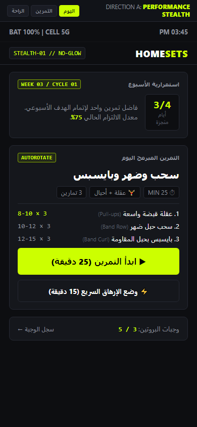
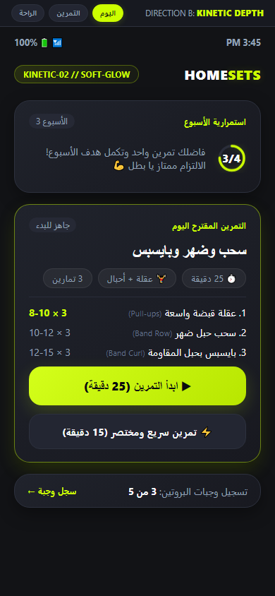
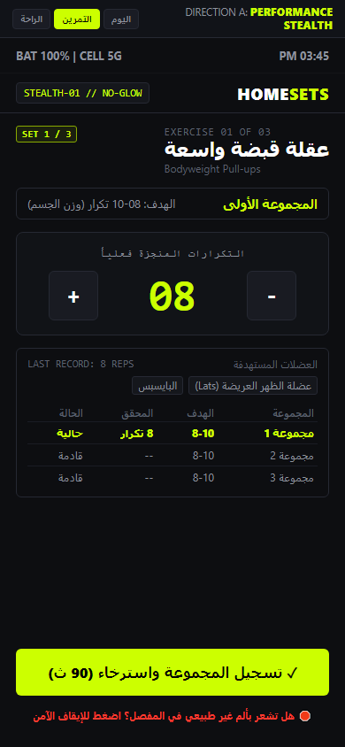
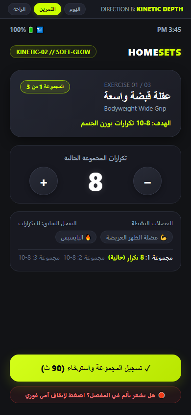
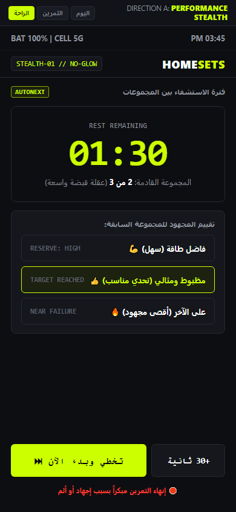
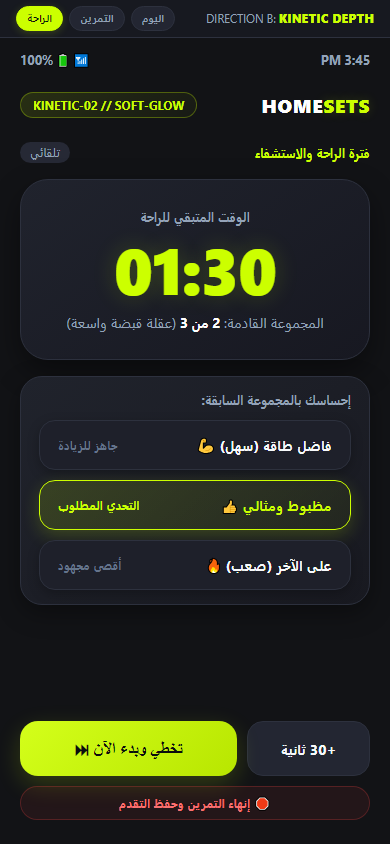

# HOMESETS — Visual Directions A/B Comparison & Decision Sheet

**Document Status:** [Final Decision Package]  
**Author:** Antigravity (Gemini 3.8 Flash High)  
**Date:** 2026-11-14  
**Target Pull Request:** [Draft PR #5](https://github.com/abuhmaid28/homesets/pull/5)  
**Reference Files:** `design/explorations/direction_a_stealth.html`, `design/explorations/direction_b_kinetic.html`  

---

## 1. Executive Purpose

To provide Product Owner Ahmed with an objective, side-by-side comparative analysis of the two fully articulated visual design directions created during Campaign C1-V2:
- **Direction A: Performance Stealth**
- **Direction B: Kinetic Depth**

Both directions honor the approved **charcoal + Performance Lime** identity while offering distinct ergonomic and psychological experiences during intense home workouts.

---

## 2. Side-by-Side Visual Comparison Matrix

| Design Dimension | Direction A: Performance Stealth | Direction B: Kinetic Depth | Ergonomic & Psychological Impact |
| :--- | :--- | :--- | :--- |
| **Primary Philosophy** | Precision Instrument / Tactical Telemetry | Tactile Elevation / Kinetic Motivation | **A** feels like a high-end stopwatch or racing cockpit; **B** feels like an energetic, premium fitness companion. |
| **Background Tone** | Deep matte charcoal (`#0D0E11`) | Warm dark charcoal (`#121316`) | Both provide OLED true-black battery efficiency; **A** has higher stark contrast; **B** has warmer depth. |
| **Card Surface** | Flat slate (`#15171C`) with 1px border (`#262933`) | Elevated container (`#1C1E26` to `#232632`) | **A** maximizes content area; **B** uses subtle shadows (`0 8px 24px rgba(0,0,0,0.35)`) to layer information. |
| **Lighting & Glow** | **Zero Glow Policy** (`box-shadow: none`) | **Soft Neon Glow** (`rgba(204, 255, 0, 0.18)`) | **A** eliminates visual glare in dark bedrooms or late-night sessions; **B** provides a dopamine-driven visual reward. |
| **Corner Geometry** | Crisp, angular corners (radius 4px–8px) | Generously rounded pills (radius 18px–24px, 999px) | **A** looks professional and technical; **B** feels friendly, soft to the touch, and modern. |
| **Typography Style** | Monospace / Tabular numerals (`SF Mono`, Consolas) | Smooth display numbers (`Cairo`, Segoe UI) | **A** ensures numbers never jitter or shift during timers; **B** is more conversational and approachable. |
| **Rep Stepper UI** | Square tactile buttons (`[-] 08 [+]`) | Circular elevated buttons with active spring scale | Both exceed 54dp for one-handed thumb reach during heavy exertion; **B** has tactile pressed-state depression. |
| **Exertion Feedback** | Monospace status badges (`RESERVE: HIGH`) | Tactile pill buttons with status glow | Both use natural Egyptian Arabic (`فاضل طاقة`, `مظبوط ومثالي`, `على الآخر`); **B** provides clearer active selection feedback. |
| **WCAG AAA Contrast** | **14.2 : 1** (Lime `#CCFF00` on `#0D0E11`) | **13.8 : 1** (Lime `#CCFF00` on `#121316`) | Both decisively exceed WCAG AAA (7.0:1) threshold for maximum outdoor and low-light legibility. |

---

## 3. Rendered Gallery Comparison

| Screen Context | Direction A: Performance Stealth | Direction B: Kinetic Depth |
| :--- | :--- | :--- |
| **Today Screen** |  |  |
| **Workout Active** |  |  |
| **Rest Timer** |  |  |

---

## 4. Product Owner Recommendation & Viable Hybrid Path

### Recommended Option: **Direction B (Kinetic Depth) with Direction A Tabular Numbers**
- **Why Direction B Wins for Home Workouts:** The home workout environment (alone in a bedroom or living room after a long workday) requires emotional warmth and kinetic momentum. Direction B’s elevated cards and gentle glow provide an engaging, rewarding feel that reduces perceived effort.
- **The Ideal Hybrid Polish:**
  - Adopt Direction B’s rounded card elevation, tactile pills, and warm charcoal background.
  - Adopt Direction A’s `font-variant-numeric: tabular-nums` for timers and counters to ensure zero layout jitter while seconds tick down.
  - Maintain the zero-cryptic-jargon Egyptian Arabic exertion labels.

---

## 5. Decision Gate for Product Owner (Ahmed)

When reviewing PR #5, select one of the following decisions:
1. **Approve Direction A (Performance Stealth):** Pure technical, zero glow, angular razor edges.
2. **Approve Direction B (Kinetic Depth):** Warm depth, soft neon glow, rounded tactile pills *(Recommended)*.
3. **Approve Hybrid (Kinetic Depth + Tabular Precision):** Direction B tactile surfaces with Direction A tabular timer numbers.
